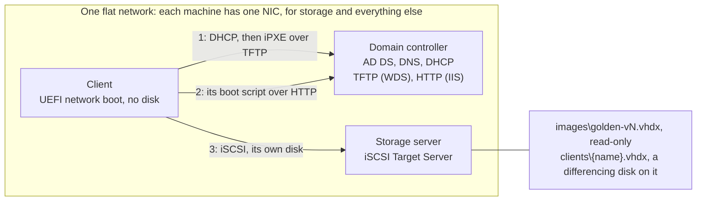

# Diskless Windows 11 from iSCSI

Windows 11 machines with no local disk boot over the network from their own iSCSI disk on a Windows Server. Each client's disk is a differencing VHDX on one shared, read-only golden image, so storage grows only with each client's own writes. A second Windows Server provides the Active Directory domain, DHCP and the network boot files.

This repo is a working implementation, and a reference for building the same thing with other tools. The docs explain what each server, the image and the clients need, and why, so that you can follow them without the scripts.

## How it works



1. **The client's firmware network-boots iPXE.** The domain controller's DHCP server hands UEFI firmware the stock `snponly.efi` over TFTP. iPXE then fetches a boot script for the client's MAC over HTTP.
2. **iPXE attaches the client's disk** on the storage server with `sanboot`, and records the session in the iBFT (iSCSI Boot Firmware Table). Windows Boot Manager starts from the disk.
3. **Windows takes over the same iSCSI session** from the iBFT as it boots. The image has every NIC driver in its driver pack as a boot driver, so it boots on any NIC the pack covers.
4. **A new disk's first boot needs nothing from outside.** A WinPE stored in the golden image runs first, makes the machine's NIC a boot NIC of that Windows, and restarts. Windows then finishes setup with its own name and joins the domain offline.
5. **Clients keep their changes until the next image update,** which gives every client a new disk on the new image.

[docs/architecture.md](docs/architecture.md) covers this in detail.

**Not covered:** Secure Boot (the stock iPXE is unsigned), CHAP authentication, backups, Windows activation (clients use Microsoft's KMS client key), and user data on a share.

## Using it

From a bash shell (WSL or Git Bash) with SSH keys that the Windows servers accept. The values for your environment go in [servers/settings.psd1](servers/settings.psd1), the passwords in `.env`, and the clients in [clients/clients.csv](clients/clients.csv).

```sh
servers/setup.sh dc             # the domain controller: a new forest, DNS, DHCP, TFTP, HTTP and the boot files
servers/setup.sh san            # the storage server: joined to the domain, iSCSI Target Server and its data disk
image/build.sh 1                # build golden-v1 on the build VM
clients/new-client.sh ws-1      # a client: its disk, identity and boot script. Then switch it on
image/change.sh 2               # golden-v2, a copy of golden-v1, running on the build VM for changes...
image/change.sh 2 --seal        # ...then sealed
clients/update-clients.sh 2     # every client onto golden-v2, while they're off
```

[docs/operations.md](docs/operations.md) has the full workflow. The image scripts and `clients/check.sh` start and stop VMs through the Proxmox API ([docs/scripts.md](docs/scripts.md#hypervisor-specific-parts) covers replacing that).

## Documentation

| Doc | What it covers |
|---|---|
| [Architecture](docs/architecture.md) | The servers and clients, how they fit together, the boot chain, the disks, and the design decisions |
| [Requirements](docs/requirements.md) | What the network, the domain controller, the storage server, client machines and the build machine need, and why |
| [Golden image](docs/golden-image.md) | How the image is built and sealed, what's configured in it and why, what makes a NIC a boot NIC, and changing an image |
| [Clients](docs/clients.md) | What a client is made of, its first boot, its Group Policy, updating and removing clients, and disk growth |
| [Operations](docs/operations.md) | The workflow with the scripts, server restarts and recovery, troubleshooting, and known limitations |
| [Scripts](docs/scripts.md) | Every file in the repo, how the scripts run on the servers, the settings, and what's specific to Proxmox |
| [Lab](docs/lab.md) | The Proxmox environment this was built and tested in, with its values |

## Repository layout

| Path | Contents |
|---|---|
| [servers/](servers) | `setup.sh` for the two servers, `remote.sh` (runs the repo's PowerShell scripts on a server over SSH), the shared PowerShell functions, and `settings.psd1`, the environment's values |
| [boot/](boot) | The iPXE scripts the domain controller serves: the first one every client fetches, and the menus for clients, the build and other machines |
| [image/](image) | Building, changing and deleting golden images, the driver pack, the WinPE startup and jobs, and the answer files and scripts that run in the image |
| [clients/](clients) | Making, updating, removing and checking clients, `clients.csv`, and the clients' Group Policy |
| [lab/](lab) | Terraform and setup scripts for the Proxmox lab, and `pve.sh`, which the scripts use to drive VMs |
| `.env.example` | The passwords the scripts read from `.env` |
