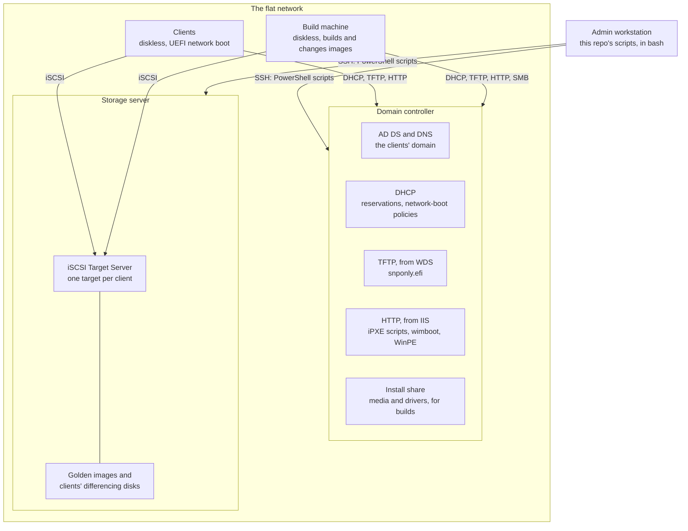
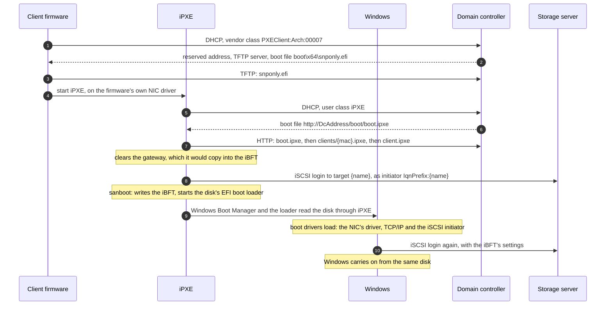
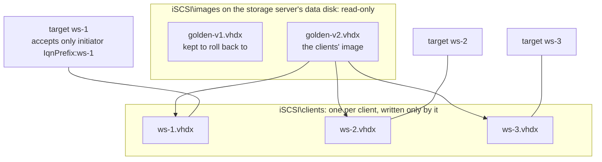

# Architecture

Diskless Windows 11 clients boot from iSCSI disks on a Windows Server, each disk a differencing VHDX on a shared golden image. This page describes the parts, how a client boots, how the disks are laid out, and why it's built this way. Values such as `<DcAddress>` are settings from [servers/settings.psd1](../servers/settings.psd1).

## Components

| Machine | Runs | Holds | Clients need it |
|---|---|---|---|
| Domain controller | AD DS and DNS for a new forest; DHCP; WDS for its TFTP server only; IIS for static files only. Windows Server 2025 | The iPXE binary, the iPXE scripts (one per client), wimboot, WinPE, Memtest86+, and a share with the Windows media and driver pack for builds | To start. Running clients carry on without it, apart from DNS and domain logons |
| Storage server | iSCSI Target Server only. Windows Server 2025, a domain member | Golden images and each client's differencing disk, on a data disk | All the time: Windows runs from its disk |
| Client | Windows 11 Enterprise LTSC 2024, from its iSCSI disk | Nothing: no local disk | |
| Build machine | WinPE and Windows setup during a build; the image's Windows during a change | Nothing: it works on a disk on the storage server | Only for building and changing images |
| Admin workstation | `bash`, `ssh`, `tar`; and for the scripts that drive VMs, the Proxmox API | This repo | No |

- **The storage server does only iSCSI,** so its load and restarts are kept apart from identity and network services. Microsoft's guide for sizing is about 60 clients per 1 GbE on the storage server.
- **The domain controller holds everything a client needs before its disk is attached.** IIS on a domain controller isn't Microsoft's preferred layout, so it serves static files only; moving the boot files to another server changes only where the scripts write them.
- **Clients and the build machine are the same kind of machine:** diskless, booting from the network. The build machine is a client whose boot script points at the build's disk instead of its own.

## Network

- **One broadcast domain** holds the clients and both servers. UEFI PXE finds its DHCP server by broadcast, and nothing here relays DHCP between networks.
- **The domain controller is the only DHCP server.** Another DHCP server would answer clients without the boot options.
- **Each machine has one NIC,** which carries iSCSI and everything else. There's no separate storage network, so ordinary single-NIC workstations can be clients.
- **Addresses:** the servers are static. Clients get DHCP reservations from a range kept out of the dynamic pool, so each client keeps its address. Other machines lease from the rest of the scope.
- **A gateway** gives clients the internet. Windows still gets it from DHCP, though the iBFT carries none ([below](#the-ibft)).

## Boot chain

1. **Firmware PXE.** UEFI x64 firmware sends a DHCP request with the vendor class `PXEClient:Arch:00007`. A DHCP policy matching that class answers with the TFTP server (option 66) and `boot\x64\snponly.efi` (option 67), along with the client's reserved address.
2. **iPXE.** `snponly.efi` is the stock iPXE build that drives the NIC through the firmware's own UEFI network driver (SNP), so any NIC that can network-boot works before Windows starts, and nothing has to be compiled.
3. **iPXE's own DHCP request** carries the user class `iPXE`. A second policy answers it with the URL of [boot/boot.ipxe](../boot/boot.ipxe). iPXE sends the PXE vendor class too, so this policy is evaluated first: for an option two matching policies both set, the first one's value wins.
4. **The boot scripts.** `boot.ipxe` chains `clients/{mac}.ipxe`, the machine's own script, or [menu.ipxe](../boot/menu.ipxe) for machines that aren't clients. A client's own script is a static file of four settings: its name, its initiator IQN, its disk (`root-path`, as `iscsi:<SanAddress>::::<target IQN>`) and then `chain ../client.ipxe`, the clients' menu.
5. **The disk.** [client.ipxe](../boot/client.ipxe) clears the gateway, then `sanboot`s the disk. iPXE logs in to the client's target, writes the iBFT, and starts `\EFI\Boot\bootx64.efi` from the disk's EFI system partition: Windows Boot Manager.
6. **Windows.** The loader reads the boot drivers through iPXE's disk. Once the kernel starts, the iSCSI initiator (`iScsiPrt`) reads the iBFT and logs in to the same target through the boot NIC, before the disk is needed again. This works only if the NIC's driver loads at boot and has a TCP/IP interface for that NIC: [golden-image.md](golden-image.md#booting-from-any-nic) covers what that takes.

### The iBFT

The iSCSI Boot Firmware Table is an ACPI table that the boot loader leaves for the operating system: the initiator's name, each NIC's address, mask, gateway and DNS, and each target's address, name and LUN. Windows' iSCSI initiator logs in again with these settings, and the boot NIC keeps the address from the iBFT, with an infinite lifetime.

**The iBFT carries no gateway.** Windows adds a route to the target through the iBFT's gateway, even when the target is on its own subnet. A gateway that doesn't route that traffic back onto the subnet breaks the connection: WinPE or Windows makes the boot session, but it never connects. iPXE copies the NIC's gateway into the iBFT, so every boot script runs `set net0/gateway 0.0.0.0` before `sanboot` or `sanhook`. Everything iPXE fetches is on the same subnet, and Windows still takes its default gateway from DHCP.

### The menus

| Machine | Its menu | Default |
|---|---|---|
| A client | [client.ipxe](../boot/client.ipxe): Windows from its disk; WinPE with its disk attached (`sanhook`), for recovery; Memtest86+; an iPXE shell | Windows, after 5 seconds |
| The build machine, during a build or change | [build.ipxe](../boot/build.ipxe): WinPE with the build disk attached, or Windows from it, chosen by the build's script | No menu |
| Any other machine | [menu.ipxe](../boot/menu.ipxe): WinPE, Memtest86+, an iPXE shell, or the next boot device | The next boot device, after 30 seconds |

**A failed disk boot goes back to the menu,** whose default boots Windows again 30 seconds later. So a client that starts while the storage server is away, or that restarts because it went away, keeps trying until its disk is back.

## Disks

- **A golden image** (`golden-vN.vhdx`) is a dynamic VHDX that Windows 11 was installed onto *as an iSCSI disk*, then sysprepped and sealed: made read-only with both the file attribute and its ACL. It's never written again, because a write to a parent breaks every child built on it. A change makes a new version from a copy.
- **A client's disk** is a differencing VHDX on a golden image (`New-IscsiVirtualDisk -ParentPath`). It holds only what the client writes.
- **One target per client,** which accepts only the client's initiator IQN, `<IqnPrefix>:<name>`, the one its boot script gives iPXE. That keeps each client on its own disk, but it isn't security: with no CHAP, any machine that presents the IQN gets the disk.
- **Clients keep their disks until the next image update.** An update gives every client a new disk on the new image, so anything stored on a client is wiped then. Windows Update is off on clients: updates arrive in new golden images, which keeps children small.
- **Old images are kept** until deleted by hand, so clients can be rolled back.

Microsoft's own example of the saving: one 40 GB base image plus 2 GB per client is 552 GB for 256 machines, instead of about 10 TB of full copies. [clients.md](clients.md#disk-growth) has what a client's disk grows to here.

## Client identity

- **Its own SID:** sysprep generalised the image, so each client's first boot gives it a new machine SID.
- **Its name and domain join** are written into its disk before its first boot: the computer name, and an offline domain join (`djoin /provision`) in the answer file that sysprep left in the image. The client joins on its first boot with no credentials on the network, and nothing has to be typed.
- **Its computer account outlives its disk.** An update provisions the join again with `/reuse`, which keeps the account (and its SID, groups and DNS records) and resets its machine password. So a running client must never be updated: it would lose its trust with the domain.

[clients.md](clients.md) covers the details.

## Booting from any NIC

One golden image, built on one machine, boots clients with other NIC models. It takes two things in the image's Windows for each client's NIC:

1. **The NIC's driver, as a boot driver,** so that the kernel can set the NIC up before any disk is there. The image's seal does this for every NIC driver in its driver pack.
2. **A TCP/IP interface for that NIC at its PCI location,** which `dism /Add-NetAdapter` makes, from the live NIC. A WinPE stored in the image does this on each client's first boot.

[golden-image.md](golden-image.md#booting-from-any-nic) explains both.

## Design decisions

| Topic | Decision | Why |
|---|---|---|
| Image hosting | iSCSI Target Server on Windows Server 2025 | Built in, with differencing VHDX. Microsoft documents it for booting many clients from one sysprepped image, with iPXE as the boot loader, and it isn't deprecated in Windows Server 2025 |
| Servers | Two: a domain controller with DHCP and the boot files, and a storage server with iSCSI only | Storage load and restarts stay separate from identity and network services |
| Boot chain | UEFI PXE, then the stock iPXE `snponly.efi`, an HTTP script, iSCSI and the iBFT | Works on any NIC that can network-boot, with nothing to compile. The iBFT lets Windows take over the session |
| Per-client boot | A static `clients/{mac}.ipxe` per client, written by the scripts | One place owns the mapping, DHCP stays generic, and there's no service to run |
| TFTP | WDS's TFTP server, with its PXE side doing nothing | First-party. Any TFTP server that serves the file would do; WDS is deprecated from the next Windows Server release, but supported for 2025's lifecycle ([requirements.md](requirements.md#tftp)) |
| Client OS | Windows 11 Enterprise LTSC 2024 | No Store apps to update, and a long servicing life |
| Installed onto | An iSCSI disk, by Windows setup in WinPE | Setup itself makes the build's NIC a boot NIC when it installs onto iSCSI. Microsoft says an image installed onto a local disk won't boot from iSCSI, as drivers load in a different order |
| Network | One flat network, one NIC per machine | Ordinary single-NIC workstations can be clients |
| Secure Boot | Off on clients | The stock `snponly.efi` is unsigned. iPXE's Microsoft-signed shim is the way to turn it on |
| Client identity | The computer name and an offline domain join, written into each new disk | Clients join on their first boot with no credentials on the network, and keep their computer accounts across updates |
| Persistence | Clients keep their disks until the next image update | Clients keep their state across restarts, and the image is updated in one place |
| NIC families | Every NIC driver in the driver pack made a boot driver when the image is sealed | Windows makes a NIC driver a boot driver by itself only for the NICs setup installs onto iSCSI through. This way a NIC family needs only its driver in the pack, not a NIC in the build ([golden-image.md](golden-image.md#booting-from-any-nic)) |
| A client's NIC | Its interface made by a WinPE that the image carries, on the client's first boot | Windows keys a boot NIC's TCP/IP binding to the NIC's PCI location, which differs between machines. From the disk, a first boot needs nothing outside the client to change, for a VM or a physical machine |
| Changing an image | A copy of the newest image, booted on the build machine, changed, and sealed again as a new version; or a new build | Changes made by hand, such as an application, need no build. A change to the build's own scripts or driver pack takes a build |
| Updating clients | The storage server takes the disks of clients that are off; only then does the domain controller make their new joins | A new join resets the computer account's password, which a running client still uses |
| A failed disk boot | iPXE goes back to its menu after 30 seconds, whose default is Windows | A client that starts while the storage server is away gets its disk once it's back, with no one there |
| Server updates | Downloaded automatically; installed, and restarted, only when an admin says so | A storage server restart pauses every client, and a domain controller restart stops clients starting, so restarts must be planned |
| Waiting for the disk | Clients wait up to 10 minutes for their disk, rather than Windows' 60 seconds | A storage server restart can take longer than a minute, and a client that stops waiting crashes ([operations.md](operations.md#when-a-server-goes-away)) |
| Tooling | Bash on the workstation, PowerShell on the Windows machines over SSH, one connection per step. Terraform for the lab's VMs | Few moving parts, and every step can be re-run. An SSH logon with a key carries no credentials for a second hop, so the workstation runs each server's part itself |

## Sources

- Microsoft, [iSCSI target boot overview](https://learn.microsoft.com/en-us/windows-server/storage/iscsi/iscsi-boot-overview): booting many clients from one sysprepped image through differencing disks, with iPXE; about 60 clients per 1 GbE; the 552 GB example.
- Microsoft Storage team, [Diskless servers can boot and run from the Microsoft iSCSI Software Target using a regular network card](https://learn.microsoft.com/en-us/archive/blogs/storageserver/diskless-servers-can-boot-and-run-from-the-microsoft-iscsi-software-target-using-a-regular-network-card): "the image installed on a local hard drive can not be used for iSCSI boot".
- Microsoft, [New-IscsiVirtualDisk](https://learn.microsoft.com/en-us/powershell/module/iscsitarget/new-iscsivirtualdisk?view=windowsserver2025-ps): `-ParentPath` makes a differencing disk.
- Microsoft, [Removed or no longer developed features in Windows Server](https://learn.microsoft.com/en-us/windows-server/get-started/removed-deprecated-features-windows-server): iSCSI Target Server isn't listed.
- Microsoft, [KB5129631](https://support.microsoft.com/help/5129631): WDS deprecated in the next Windows Server release, and working on the versions supported now.
- iPXE, [Booting from an iSCSI target with WDS](https://ipxe.org/howto/wds_iscsi): Windows "will always create a static route to the iSCSI target via the default gateway"; `set netX/gateway 0.0.0.0` when booting doesn't need the gateway.
- iPXE, [sanboot](https://ipxe.org/cmd/sanboot) and [sanhook](https://ipxe.org/cmd/sanhook): the disk is described to the operating system through the iBFT.
- iPXE developers' list, [shim signed by Microsoft](https://lists.ipxe.org/pipermail/ipxe-devel/2025-November/007651.html): Secure Boot with iPXE.
