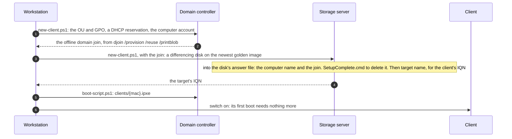
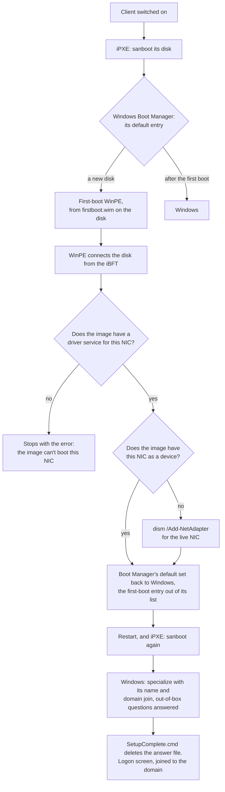
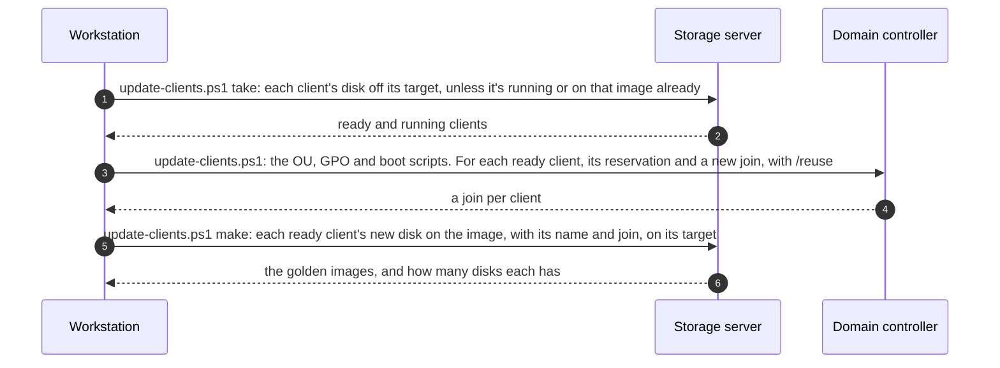

# Clients

A client is a machine with no disk that boots from its own differencing disk on a golden image, and is joined to the domain. Making one takes a disk, an identity written into it, a target, a boot script and a DHCP reservation; the machine then only has to be switched on. This page covers what each part is and why, the client's first boot, its Group Policy, and updating and removing clients. Values such as `<SanAddress>` are settings from [servers/settings.psd1](../servers/settings.psd1).

## What a client is

| | Where | What |
|---|---|---|
| Disk | Storage server: `iSCSI\clients\<name>.vhdx` | A differencing disk on a sealed golden image, with the client's computer name and domain join in its answer file |
| Target | Storage server: target `<name>` | Has the disk as its LUN, and accepts only the client's initiator, `<IqnPrefix>:<name>` |
| Boot script | Domain controller: `<BootFiles>\clients\{mac}.ipxe`, the MAC in lower case with hyphens | Its name, initiator and disk, then the clients' menu ([architecture.md](architecture.md#boot-chain)) |
| Address | Domain controller: a DHCP reservation for its MAC | From the range kept out of the dynamic pool |
| Computer account | Active Directory: in the OU `<ClientOu>` | Made by `djoin /provision`. The GPO `<ClientGpo>` is linked to that OU ([below](#group-policy)) |
| Row | [clients/clients.csv](../clients/clients.csv): name, MAC, address | What the client scripts make the rest from |

The disk lasts until the next image update or the client's removal. Everything else lasts until the client is removed.

## Making a client



[clients/new-client.sh](../clients/new-client.sh) makes one from its row in `clients.csv`:

1. **On the domain controller** ([new-client.ps1](../clients/dc/new-client.ps1)): the clients' OU and GPO, if they're missing; a reservation for the client's MAC at its address; and its computer account in the OU, with an offline domain join:
   ```bat
   djoin /provision /domain <DomainName> /machine <name> /machineou "OU=<ClientOu>,DC=..." /reuse /savefile <file> /printblob
   ```
   `/printblob` prints the join as a base64 blob for an answer file. `/reuse` keeps an existing account and resets its machine password, so a client keeps its account when its disk is made again.
2. **On the storage server** ([new-client.ps1](../clients/san/new-client.ps1), with [disk.ps1](../clients/san/disk.ps1)): a differencing disk on the newest sealed image, or the version given:
   ```powershell
   New-IscsiVirtualDisk -Path <data drive>:\iSCSI\clients\<name>.vhdx -ParentPath <data drive>:\iSCSI\images\golden-v<N>.vhdx
   ```
   It mounts the disk and writes the client's identity into `Windows\Panther\unattend.xml`, the answer file that sysprep left there, which the first boot reads for its specialize and oobeSystem passes. In the specialize pass, `ComputerName` changes from `*` (random) to the client's name, and the join goes in:
   ```xml
   <component name="Microsoft-Windows-UnattendedJoin" processorArchitecture="amd64" publicKeyToken="31bf3856ad364e35" language="neutral" versionScope="nonSxS">
     <Identification><Provisioning><AccountData>...the blob...</AccountData></Provisioning></Identification>
   </component>
   ```
   It also writes `Windows\Setup\Scripts\SetupComplete.cmd`, which deletes that answer file: Windows runs it at the end of setup, as SYSTEM. Then target `<name>`, which accepts only `IQN:<IqnPrefix>:<name>`, with the disk mapped to it.
3. **On the domain controller** ([boot-script.ps1](../clients/dc/boot-script.ps1)): the client's boot script, checked over HTTP as iPXE will fetch it:
   ```
   #!ipxe
   set client <name>
   set initiator-iqn <IqnPrefix>:<name>
   set root-path iscsi:<SanAddress>::::<target IQN>
   chain ../client.ipxe
   ```

- **The join's blob holds the computer account's machine password.** The domain controller prints it, the workstation passes it straight to the storage server without showing or keeping it, and it's written only into the client's disk, where `SetupComplete.cmd` deletes it once setup is done. No image password is needed.
- **The iSCSI target holds a disk's file open while the disk is in its list.** To mount a disk on the storage server, take it out of the list (`Remove-IscsiVirtualDisk`, which keeps the file), mount it, bring it online if Windows Server's SAN policy leaves it offline, then put it back (`Import-IscsiVirtualDisk`) with its target mapping. The client must be off. `Use-WindowsVolume` in [servers/common.ps1](../servers/common.ps1) does this.
- **A client with a disk already is refused:** remove it first.

## The first boot



A client's NIC needs a network interface in the disk's Windows before Windows can boot from it, unless the image has that NIC already ([golden-image.md](golden-image.md#the-interface-and-device-identity)). `dism /Add-NetAdapter` makes it from the live NIC, so it runs on the client, in WinPE, before Windows' first boot. The golden image does this itself:

1. **Windows Boot Manager on the new disk starts the first-boot WinPE,** its default entry, as a RAM disk from `Windows\Setup\Diskless\firstboot.wim` on the disk.
2. **WinPE connects the disk from the iBFT,** as WinPE booted by iPXE does, and [startnet-firstboot.cmd](../image/winpe/startnet-firstboot.cmd) runs [firstboot.ps1](../image/winpe/firstboot.ps1) from it:
   - it finds the NIC: the connected physical one;
   - it checks that the image has the NIC's driver service, which it has for each NIC driver in its driver pack. Without one it stops: the image can't boot this NIC;
   - if the image doesn't have the NIC itself, as a device (`Enum\<device ID>`) in its `SYSTEM` hive, it runs `dism /Add-NetAdapter /HostAdapter:{GUID} /BootDriver:ms_tcpip /BootDriver:ms_tcpip6` on the disk's Windows;
   - it sets the boot manager's default, in the disk's EFI system partition, back to Windows, takes its own entry out of the boot manager's list, and restarts.
3. **Windows boots,** finishes setup with the client's name, joins the domain, and stops at the logon screen.

| | |
|---|---|
| WinPE | The network WinPE with its own startup ([golden-image.md](golden-image.md#winpe)), about 0.5 GB, stored once in the golden image |
| Its boot entry | `{bd965c03-fdb1-459d-9aa1-04822bba2c6b}`: an OS loader entry for a RAM disk, `ramdisk=[C:]\Windows\Setup\Diskless\firstboot.wim`, with `boot.sdi` beside it. First in the boot manager's list, its default, with a timeout of 0 |
| Time | About 3 minutes more than a normal first boot: a client is set up and joined 5–7 minutes after it's switched on, with one restart |
| Log | `Windows\Temp\firstboot.log` on the client's disk. On a failure, WinPE stops with the error on screen, and its entry stays the default, so the next start tries again |

- **Why from the disk:** nothing outside the client has to change between its two boots. Its boot script is a static file, which WinPE has no way to change. So a client is ready as soon as it's made, VM or physical, and an image update, which gives every client a new disk, needs nothing per machine.
- **Boot Manager starts only entries in its list (`displayorder`),** whatever its default is. So the entry is put first in the list too, and the timeout of 0 means there's no menu.

**To run it again,** for example before a client's NIC is replaced: in Windows on the client,
```bat
bcdedit /displayorder {bd965c03-fdb1-459d-9aa1-04822bba2c6b} /addfirst
bcdedit /default {bd965c03-fdb1-459d-9aa1-04822bba2c6b}
```
Or give it a new disk, with an update.

## Group Policy

The GPO `<ClientGpo>`, linked to the OU `<ClientOu>` that holds the clients' computer accounts ([clients/dc/policy.ps1](../clients/dc/policy.ps1)):

| Setting | How | Why |
|---|---|---|
| Windows Update off | Policy: Configure Automatic Updates, Disabled | Updates come in new golden images. Updating each client would grow every client's disk by the same updates |
| No sleep | Policies: sleep timeout 0, and standby states (S1–S3) not allowed, plugged in and on battery | The disk is on the network |
| No hibernation | Policy: hibernate timeout 0. Preference: `HibernateEnabled` 0 in `HKLM\SYSTEM\CurrentControlSet\Control\Power` | Hibernation writes memory to the disk, and resumes from it |
| No fast startup | Preference: `HiberbootEnabled` 0 in `HKLM\SYSTEM\CurrentControlSet\Control\Session Manager\Power` | Fast startup is a hibernation |
| A fixed pagefile | Preference: `PagingFiles` `C:\pagefile.sys <PagefileMB> <PagefileMB>` in `...\Session Manager\Memory Management` | The pagefile is on the client's disk, and every page written grows it. Fixed, it can't grow unseen. It takes effect from the boot after the policy first applies |
| NIC power saving off | A startup script ([clients/dc/nic-power.ps1](../clients/dc/nic-power.ps1)): `PnPCapabilities` 24 in each physical NIC's driver key | It's a setting of each NIC's device, so no policy has it. Written to the registry, it takes effect from the next boot: changing it through the NIC's own settings would restart the NIC, and with it the iSCSI connection the client runs from |

- **Policies and preferences.** The update and power settings are policies; the rest have no policy, so they're Group Policy preferences, which write the registry.
- **Change only what differs.** Each change is a new version of the GPO, which every client applies again. `Set-GPPrefRegistryValue` adds a new item each time it's run, so the script compares first.
- **The startup script** goes into the GPO's `Machine\Scripts\Startup` folder in SYSVOL, with a `scripts.ini`, and the GPO lists the scripts extension in its client-side extensions. Startup scripts run under the execution policy, which allows no scripts by default, so a `.cmd` starts PowerShell with `-ExecutionPolicy Bypass`.

## Updating clients

[clients/update-clients.sh](../clients/update-clients.sh) moves clients to another golden image: every client in `clients.csv` that has a disk, or the ones named. Each gets a new disk on that image, made as for a new client, so its next start is a first boot again, with nothing to do per machine. Run it while the clients are off.



| Kept | Made again |
|---|---|
| The computer account, with its SID, groups and DNS records; the target and its IQN; the boot script; the reservation | The disk: the client's machine SID, its local profiles and anything else stored on it. Wiping them is the point of an update |

- **Never for a running client.** A new join resets the computer account's machine password, which a running client still uses: it would lose its trust with the domain. So the domain controller's step comes only after the storage server has found the client off, by its target having no session, and taken its disk away so that it can't start. A running client is reported and left as it is, and the script exits with an error: switch it off and run the same again. Clients already on the image are skipped.
- **A client switched off a moment ago** keeps its session for a couple of minutes, until the target's idle check. The first step waits up to 2.5 minutes for that.
- **A failure** leaves the clients it hadn't finished with no disk on their targets. They get iPXE's "Booting windows failed", and keep retrying, until the next run.
- **Rolling back** is the same, with the older version.
- **Old golden images are listed, not deleted.** They're kept to roll back to, until deleted with `image/remove.sh <version>`, which refuses while any disk is on the image.
- **Changes to the boot scripts and the GPO** reach the domain controller with an update, too.

## Removing a client

[clients/remove-client.sh](../clients/remove-client.sh) reverses `new-client.sh`. On the storage server, the target and the disk, refused while the client's target has a session. Then on the domain controller: the boot script, the reservation and its leases, the client's DNS records (A and PTR) and its computer account. The machine then gets the menu for machines that aren't clients. Its row in `clients.csv` stays.

A removed reservation leaves its lease, and `Get-DhcpServerv4Reservation -IPAddress` returns that lease as if it were a reservation. So the scripts look reservations up in the scope's list, and remove the client's leases with its reservation.

## Disk growth

| | Size |
|---|---|
| The golden image, stored once | About 12 GB |
| A client's disk after its first boot | 1.1–1.3 GB |
| A user's first logon | About 0.4 GB more |
| After Windows' first automatic maintenance, which starts about 15 minutes after the client is switched on | About 2.8 GB ([golden-image.md](golden-image.md#keeping-clients-disks-small)) |
| Then | The client's own writes, until the next update. The pagefile as it's written, up to its fixed size |

A differencing disk grows by 2 MB blocks, the first time any part of a block is written, and never shrinks: the iSCSI target presents the disk as fully provisioned, so Windows can't trim it. An update starts each client from a new, small disk.

## Sources

- Microsoft, [Djoin](https://learn.microsoft.com/en-us/previous-versions/windows/it-pro/windows-server-2012-r2-and-2012/ff793312(v=ws.11)): `/reuse` resets the account's password; `/printblob` makes a blob for an answer file.
- Microsoft, [UnattendedJoin: Provisioning, AccountData](https://learn.microsoft.com/en-us/windows-hardware/customize/desktop/unattend/microsoft-windows-unattendedjoin-identification-provisioning-accountdata): the offline join in the specialize pass.
- Microsoft, [Add a custom script to Windows Setup](https://learn.microsoft.com/en-us/windows-hardware/manufacture/desktop/add-a-custom-script-to-windows-setup): `SetupComplete.cmd`.
- Microsoft, [New-IscsiVirtualDisk](https://learn.microsoft.com/en-us/powershell/module/iscsitarget/new-iscsivirtualdisk?view=windowsserver2025-ps): `-ParentPath` makes a differencing disk.
- Microsoft, [about_Execution_Policies](https://learn.microsoft.com/en-us/powershell/module/microsoft.powershell.core/about/about_execution_policies): Windows clients allow no scripts by default.
