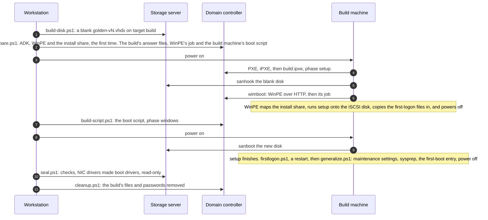
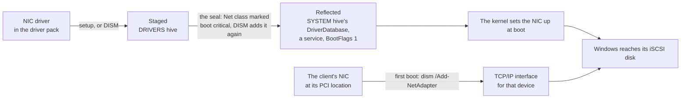
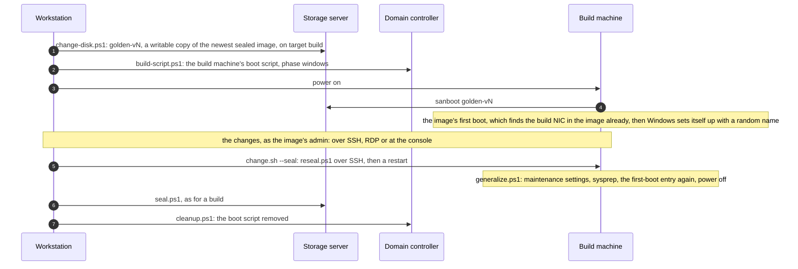

# The golden image

A golden image is a sysprepped Windows 11 Enterprise LTSC 2024, installed onto an iSCSI disk and then sealed read-only. Clients boot from differencing disks on it. This page covers what's configured in it and why, how it's built and sealed, what lets it boot from different NICs, and how to change it. Values such as `<DcAddress>` are settings from [servers/settings.psd1](../servers/settings.psd1).

Images are versioned: `golden-v<N>.vhdx` in `iSCSI\images` on the storage server's data disk. A new version comes from a new build ([image/build.sh](../image/build.sh)) or from changing a copy of the last one ([image/change.sh](../image/change.sh)).

## What's in it

| | Setting | Why |
|---|---|---|
| Windows | Windows 11 Enterprise LTSC 2024 (image `<ImageIndex>` of the media's `install.wim`), with Microsoft's KMS client key (`<ProductKey>`) | No Store apps to update, and a long servicing life. The KMS client key installs it; without a KMS host it stays unactivated |
| Disk | A dynamic VHDX of `<ImageSizeGB>` GB: an EFI system partition, MSR, and the Windows volume `C:`, labelled `Windows`, then setup's recovery partition | The scripts find the Windows volume by its label when they mount a disk on the storage server |
| Installed onto | An iSCSI disk, by Windows setup in WinPE | Setup makes the NIC it installs through a boot NIC of the new Windows. Microsoft says an image installed on a local disk can't be used for iSCSI boot ([below](#setup-onto-iscsi)) |
| Driver pack | Every driver in [image/drivers.psd1](../image/drivers.psd1), added by setup before the image first starts: virtio-win 0.1.302 (each driver's Windows 11 folder), Intel 82574L 12.15.22.6 and VMware vmxnet3 1.9.21.0. And the QEMU guest agent | Drivers for every client the image is meant for. The guest agent lets the scripts check VM clients; on a physical machine its service stays stopped |
| Boot NIC drivers | Every NIC driver in the pack made a boot driver, by the seal | So clients with any NIC the pack covers can boot it ([below](#booting-from-any-nic)) |
| The iSCSI initiator | Holds a disk's requests for up to 10 minutes while it reconnects (`MaxRequestHoldTime` 600, rather than 60) | Clients pause while the storage server restarts, rather than crash ([below](#the-iscsi-timeout)) |
| Accounts | A local administrator, `<ImageUser>`, and the built-in Administrator, both with `IMAGE_PASSWORD` from `.env` | Every client has them, so the password is kept apart from the servers' |
| Remote access | OpenSSH Server (Microsoft's MSI) with the admins' keys from the domain controller, RDP, and ping, on every network profile | Changing an image over SSH, and looking at clients |
| Windows Update | Off, by local policy (`NoAutoUpdate` 1). `build.sh --updates` installs updates during the build | Clients get updates in new images: updating each client would grow every client's disk by the same updates. It would also hold up the build |
| BitLocker | No automatic device encryption (`PreventDeviceEncryption` 1, in the specialize pass) | Windows 11 encrypts its disk by itself once set up, if there's a TPM. Sysprep refuses an encrypted disk, and on a client, encrypting would write the whole disk into its differencing disk |
| Power | No standby, no hibernation | The disk is on the network. Fast startup is a hibernation. Group Policy sets the same on clients ([clients.md](clients.md#group-policy)) |
| Automatic maintenance | No last-access times, no boot optimization, no scheduled defrag, no swap assessment, and .NET's native images compiled | Otherwise each client does these into its own disk, and grows it by gigabytes ([below](#keeping-clients-disks-small)) |
| Sysprep | Generalised for other hardware (no `/mode:vm`), keeping installed devices (`PersistAllDeviceInstalls`) | Clients aren't the build machine. Keeping devices keeps the build NIC's interface ([below](#the-interface-and-device-identity)) |
| Its answers | A random computer name, no out-of-box questions, the same accounts ([sysprep.xml](../image/windows/sysprep.xml)) | A client's first boot needs no one there. The client scripts write each client's name and domain join into its own copy ([clients.md](clients.md#making-a-client)) |
| First boot | A WinPE (`Windows\Setup\Diskless\firstboot.wim`) and a boot entry that starts it, as Windows Boot Manager's default | Makes each client's NIC a boot NIC on its first boot ([clients.md](clients.md#the-first-boot)) |
| Regional settings | `<Locale>` formats and keyboard, `<UILanguage>` display, `<TimeZone>` | The display language has to be one the media has, or setup stops to ask |

A sealed image is about 12 GB, of which about 0.5 GB is the first-boot WinPE.

## How an image is built



### The build disk

A blank dynamic VHDX, `golden-v<N>.vhdx`, on a target called `build` that accepts only the build machine's initiator IQN ([build-disk.ps1](../image/san/build-disk.ps1)). The target keeps a session for about two minutes after its initiator powers off, until its idle check logs it off, so the scripts wait for the target to be idle before changing it.

### WinPE

The domain controller makes one WinPE ([prepare.ps1](../image/dc/prepare.ps1)) from the Windows ADK's, and serves it over HTTP for wimboot:

- **Optional components:** WMI and SecureStartup, which Windows 11's setup needs; .NET, scripting, PowerShell, the storage cmdlets and the DISM cmdlets, for the jobs and for recovery.
- **The driver pack's NIC drivers,** so that WinPE can reach the iSCSI disk and the share on the build machine's NIC, and on any client's.
- **Its startup,** [startnet.cmd](../image/winpe/startnet.cmd): once the network is up, it fetches `http://<DcAddress>/boot/jobs/{mac}.cmd` for the machine's MAC, and runs it. Without a job, WinPE stops at a prompt, which is what clients' recovery boot gets. So one WinPE serves every machine, and nothing has to be injected through wimboot (which names an injected file after its URL unless given `--name`).
- **The boot configuration:** wimboot takes the boot manager from the WIM but not its BCD, which comes from the ADK's WinPE media, with `boot.sdi`. Without it, Boot Manager stops with `\EFI\Microsoft\Boot\BCD` missing (0xc000000f).

**WinPE connects the iSCSI disk itself,** from the iBFT, once plug and play has loaded the NIC's driver: a minute or two after it starts. The NIC drivers are only staged in WinPE, which is fine in a RAM disk. The job waits up to 3 minutes for the disk.

WinPE's iSCSI Initiator *service* doesn't start in Windows 11's WinPE, because WinPE runs the event log in a reduced mode. It isn't needed: the kernel driver makes the iBFT connection. The build's job starts it only for its diagnostics, after the documented workaround.

**The first-boot WinPE** is the same WinPE with another startup, [startnet-firstboot.cmd](../image/winpe/startnet-firstboot.cmd), which runs the first-boot step from the client's own disk ([clients.md](clients.md#the-first-boot)). The build copies it into the image.

### The install share

`\\<DcAddress>\install` holds the Windows media (copied from an ISO in the domain controller's CD drive), the driver pack and the guest agent. The driver pack is downloaded once, checked against SHA-256 hashes pinned in `drivers.psd1`; downloads send their own user agent, as fedorapeople.org answers anything that looks like a browser with a proof-of-work page.

WinPE maps the share by address, with a domain account that nothing else uses (`<ShareAccount>`): the iBFT may give WinPE no DNS server. Each build gives the account a new random password and enables it; the build's end disables it again.

**Passwords during a build:**
- the share's password is in WinPE's job, which is served over anonymous HTTP;
- the image's password is in the answer files on the share, readable only by admins and the share's account;
- both are removed when the build ends, however it ends ([cleanup.ps1](../image/dc/cleanup.ps1));
- Windows blanks the passwords in its own copy of the answers once a client has used them.

### Setup onto iSCSI

WinPE's build job, [build.cmd](../image/winpe/build.cmd):
1. maps the share, and waits for the iSCSI disk;
2. writes the largest disk's number into its copy of [autounattend.xml](../image/windows/autounattend.xml), which says disk 0;
3. sets setup's `BypassSecureBootCheck`, as Secure Boot is off;
4. runs `Z:\media\sources\setup.exe /unattend:... /noreboot`;
5. copies the first logon's files into the new Windows (`Windows\Setup\build`), and powers off.

- **`sources\setup.exe` is the previous version of setup.** Windows 11 24H2's new setup closes itself at an iSCSI disk.
- **The driver pack is in the answer file's offlineServicing pass,** which setup applies to the new Windows once it has applied the image. In the windowsPE pass, setup would apply the drivers to the running WinPE too, which fails in the ADK's WinPE ("Windows could not apply the Windows PE bootstrap setting", `E_INVALIDARG` at `PathAndCredentials` in `setuperr.log`).
- **`/noreboot`** leaves time to copy files in. The build machine then boots the new disk with `sanboot` rather than WinPE.

**What setup does for an iSCSI disk:** it matches the iBFT's NIC to one of WinPE's (`NICs in iBFT: 1; NICs resolved: 1` in `setupact.log`). It then adds the driver package that WinPE uses for that NIC to the new Windows as a boot driver, and runs `dism /Add-NetAdapter` for the NIC (`Windows\Panther\iscsi_boot_net.log`). That makes the build machine's NIC a boot NIC of the image. Setup does this for the first two NICs in the iBFT and no more. The seal does it for the rest of the driver pack ([below](#booting-from-any-nic)).

### First logon and generalising

Setup finishes in the new Windows, and the answer file logs `<ImageUser>` on once to run [firstlogon.ps1](../image/windows/firstlogon.ps1):
1. Windows Update off, by local policy. It would otherwise start now, and everything else would wait for it.
2. The QEMU guest agent; OpenSSH Server, from Microsoft's MSI on GitHub (Windows 11 has it only as an optional feature from Windows Update, which can take half an hour), with the admins' keys; updates, with `--updates`; RDP and ping.
3. No standby or hibernation, and the iSCSI timeout ([below](#the-iscsi-timeout)).
4. A task to run [generalize.ps1](../image/windows/generalize.ps1) as SYSTEM at the next startup, then auto-logon and the answer files removed, and a restart.

`generalize.ps1`:
1. Decrypts the disk if Windows encrypted it anyway: sysprep refuses an encrypted disk.
2. The maintenance settings, and .NET's native images ([below](#keeping-clients-disks-small)).
3. Deletes downloaded updates. Trimming free space can't shrink the image: the iSCSI target presents the disk as fully provisioned, so Windows can't trim it, and `Optimize-Volume -ReTrim` fails.
4. Waits for Windows servicing (`TiWorker`) to stop, then runs `sysprep /generalize /oobe /quiet /quit` with [sysprep.xml](../image/windows/sysprep.xml). Sysprep fails while servicing has work pending (0x80010108, "Failed to query pending CBS operations"), so it tries up to three times. Sysprep exits 0 even when it fails, so success is the image state it leaves, `IMAGE_STATE_GENERALIZE_RESEAL_TO_OOBE`.
5. Adds the first boot ([firstboot-entry.ps1](../image/windows/firstboot-entry.ps1)): moves `firstboot.wim`, `boot.sdi` and [firstboot.ps1](../image/winpe/firstboot.ps1) to `C:\Windows\Setup\Diskless`, and creates a RAM disk boot entry for the WIM, first in the boot manager's list, as its default, with a timeout of 0.
6. Deletes the build's files, and powers off.

**The first-boot entry is made by the running Windows,** after sysprep. Made with `bcdedit` on the storage server, with the image mounted, it would name the VHDX file (`vhd=[D:]\iSCSI\...`), which a client can't find; here it names the Windows partition by its own identity, which every client's disk shares. The files are moved rather than copied, as a copy's blocks would stay in the VHDX after the build's files are deleted.

### The seal

Once the build machine is off, [seal.ps1](../image/san/seal.ps1) on the storage server:
1. takes the disk off the build target, and out of the iSCSI target's list, which otherwise holds the file open;
2. mounts it, and checks that it's generalised (`Windows\Setup\State\State.ini`) and has the first boot's three files;
3. makes the driver pack's NIC drivers boot drivers ([below](#how-the-seal-does-it));
4. makes it read-only: the read-only attribute, and an ACL that lets only SYSTEM and Administrators read it. The iSCSI target reads a parent as SYSTEM. Admins can still clear the attribute and delete the file through the folder's permissions ([image/remove.sh](../image/remove.sh)).

A write to a parent breaks every differencing disk on it, which is why both protections are there.

## Booting from any NIC



Windows booting from iSCSI needs its boot NIC working before the disk is there. For a NIC, that takes two things in the image:

1. **Its driver package reflected as critical:** in the `SYSTEM` hive's driver database (`DriverDatabase`, with the package's configuration for each device it lists), with its service, and `BootFlags` 1 on the service, which loads it at boot when booting from the network. The kernel then sets up a device of that model while it boots. Without it, Windows stops with INACCESSIBLE_BOOT_DEVICE at once.
2. **A network interface for that device, at its PCI location:** what `dism /Add-NetAdapter` writes, binding TCP/IP to the NIC at boot. Without it, Windows stops with INACCESSIBLE_BOOT_DEVICE a few minutes into the boot.

The image gets the first for every NIC in its driver pack when it's sealed. Each client gets the second on its first boot, unless the image has its NIC already.

### Why NIC drivers aren't boot drivers by themselves

Windows keeps each driver package in one of two driver databases: the `SYSTEM` hive's, which the kernel reads while it boots, or the `DRIVERS` hive's, which it can't read until the boot disk is there. A package goes into the `SYSTEM` hive's database, and is configured there with its service and a configuration for each device it lists, only if its device class is marked boot critical. The mark is the class property `DEVPKEY_DeviceClass_BootCritical`, stored as `Control\Class\{class}\Properties\{6a3433f4-5626-40e8-a9b9-dbd9ecd2884b}\0003`. The SCSIAdapter class has it; the Net class doesn't.

So DISM, an answer file's driver paths, and installing a driver in a running Windows only *stage* a NIC driver: its name and version in the `DRIVERS` hive, with no service and no configuration. Setup forces the reflection only for the NICs it takes from the iBFT: `Windows\INF\setupapi.offline.log` shows it adding WinPE's copy of the package again, and "Forcing driver package to be boot critical".

Setting `BootFlags` or `Start` on a staged NIC's service doesn't help: without the reflected package there's no service to set, and the kernel has no configuration for the device. Windows 7's way of booting other NICs, the Critical Device Database, has been gone since Windows 8.

### How the seal does it

With the boot-critical mark on the Net class, DISM reflects NIC drivers as it does storage drivers. So the seal (`Set-BootNicDrivers` in [servers/common.ps1](../servers/common.ps1)) does this in the offline image, for each NIC package that's only staged:

1. **The mark:** SCSIAdapter's `0003` property copied to the Net class, in the image's `SYSTEM` hive. Administrators can't open a class's `Properties` key, so `reg.exe` does it as SYSTEM, through a one-off scheduled task.
2. **The packages:** each removed (`dism /Remove-Driver`) and added again (`dism /Add-Driver`), from a copy of its files.
3. **The mark removed,** however the step ended. The packages stay where DISM put them.
4. **`BootFlags` 1 on the services of all the NIC packages.** DISM writes a service afresh, without it.

By hand, for virtio's NetKVM in an image mounted as `E:`. `ControlSet001` is the image's current control set (from `Select\Current`), `oem5.inf` the package's published name (`dism /Image:E:\ /Get-Drivers`), and `C:\copy\netkvm` a copy of its folder in the image's driver store, taken before it's removed. `reg copy` and `reg delete` must run as SYSTEM:

```bat
reg load HKLM\img E:\Windows\System32\config\SYSTEM
reg copy "HKLM\img\ControlSet001\Control\Class\{4d36e97b-e325-11ce-bfc1-08002be10318}\Properties\{6a3433f4-5626-40e8-a9b9-dbd9ecd2884b}\0003" "HKLM\img\ControlSet001\Control\Class\{4d36e972-e325-11ce-bfc1-08002be10318}\Properties\{6a3433f4-5626-40e8-a9b9-dbd9ecd2884b}\0003" /s /f
reg unload HKLM\img
dism /Image:E:\ /Remove-Driver /Driver:oem5.inf
dism /Image:E:\ /Add-Driver /Driver:C:\copy\netkvm\netkvm.inf
reg load HKLM\img E:\Windows\System32\config\SYSTEM
reg delete "HKLM\img\ControlSet001\Control\Class\{4d36e972-e325-11ce-bfc1-08002be10318}\Properties\{6a3433f4-5626-40e8-a9b9-dbd9ecd2884b}\0003" /f
reg add HKLM\img\ControlSet001\Services\netkvm /v BootFlags /t REG_DWORD /d 1 /f
reg unload HKLM\img
```

A package that's reflected already, the build NIC's by setup or any by an earlier seal, is left as it is, so sealing a changed image redoes only what's missing. A package is reflected once `HKLM\img\DriverDatabase\DriverInfFiles\<oemN.inf>` exists in the image's `SYSTEM` hive; the seal stops if one isn't. DISM reads the mark from the image, not from the storage server's own Net class.

### The interface and device identity

`dism /Add-NetAdapter /HostAdapter:{NIC GUID} /BootDriver:ms_tcpip /BootDriver:ms_tcpip6` writes a live NIC's interface into an offline image, keyed to the NIC's location path, such as `PCIROOT(0)#PCI(1E00)#PCI(0100)#PCI(1200)`. It needs the live NIC, so it runs on the client, in WinPE. Microsoft doesn't document it; setup runs it for its iSCSI NICs.

Windows names a PCI device by its model and its location, or by its PCIe serial number where the device has one. Sysprep keeps installed devices (`PersistAllDeviceInstalls`), so the build machine's NIC, with its interface, stays in the image. A client NIC of the same model at the same PCI location, with no serial number, is the same device, and needs nothing: in VMs, `net0` of the build NIC's model is such a NIC. Any other NIC is a new device, and needs its interface: another model, another slot, and physical NICs.

### The driver pack

Each NIC family is a driver package, which covers every device its INF lists:

| Driver | Package | Covers |
|---|---|---|
| Intel 1 GbE: the build NIC's, made a boot driver by setup | `net1ix64.inf` 12.15.22.6, a Microsoft-published build of Intel's driver (Microsoft Update Catalog). Its INF sets `BootFlags` 1 | Intel 82574L, which is QEMU's e1000e (`PCI\VEN_8086&DEV_10D3`). And physical Intel 1 GbE NICs: 82579, I217, I218, the early I219 revisions, I210/I211, I350, 82575/82576/82580. Not later I219 revisions, I225/I226 or 10 GbE. Check a NIC's PCI ID against the INF |
| VMware vmxnet3 | `vmxnet3.inf` 1.9.21.0 (Microsoft Update Catalog) | VMware's virtual NIC (`PCI\VEN_15AD&DEV_07B0`), which QEMU and Proxmox VMs can have too |
| virtio NetKVM | `netkvm.inf` from virtio-win 0.1.302 | QEMU's virtio-net, legacy and modern (`PCI\VEN_1AF4&DEV_1000`, `DEV_1041`) |

**To boot another NIC family,** such as workstations' Realtek, Intel I225/I226 or later I219 NICs: add its driver package to [image/drivers.psd1](../image/drivers.psd1), make WinPE again, and build a new image. The NIC needn't be in the build machine. WinPE gets the driver too, which it needs to reach the disk through that NIC on a client's first boot. The seal stops if it can't reflect a package. Whether the driver then boots shows on the first machine with that NIC.

### Why the build machine has one Intel NIC

- **Setup takes only the first two NICs in the iBFT,** whatever they are: with three NICs and three targets in iPXE's iBFT, setup logs `NICs in iBFT: 2; NICs resolved: 2`, and makes only those two boot NICs. The seal covers every family in the pack, so the build needs only one.
- **Setup can't make virtio's NetKVM a boot driver:** it fails with "a required driver could not be installed" (0x80070001), and an image built on a virtio NIC fails at setup. The seal reflects the same package without trouble, so virtio clients boot.

[image/nic-test.sh](../image/nic-test.sh) boots an image on a VM client with a given NIC model, to check that the NIC boots ([scripts.md](scripts.md#image)).

## Keeping clients' disks small

Windows runs automatic maintenance when a machine is idle: defragmenting, compiling .NET's native images, Defender's scans and some 50 smaller tasks. A new client has never had any, so it starts about 10 minutes after the client's Windows starts, at its logon screen. Everything it moves or writes lands in the client's differencing disk for good: the iSCSI target can't trim it.

**And a client's disk grows by whole 2 MB blocks.** The first write to any 2 MB of the disk, even of 4 KB, makes the differencing disk 2 MB larger. So what counts isn't how much maintenance writes, but how far over the disk it spreads its writes. Left alone, a new client's disk grows from about 1.5 GB to 7.5–8 GB at its first maintenance; with these settings, to about 2.8 GB.

[generalize.ps1](../image/windows/generalize.ps1) sets them before sysprep:

| Setting | How | Why |
|---|---|---|
| No last-access times | `fsutil behavior set disablelastaccess 1` | Windows keeps last-access times on volumes up to 128 GB ("system managed"). Maintenance reads files all over the disk, and NTFS writes each file's last access into its record and its directory's index: a small write in nearly every directory, each a new 2 MB block: about 1.3 GB of growth. Setting it to 1 makes it user managed, so Windows doesn't turn it back on |
| No boot optimization | `EnableAutoLayout` 0 in `HKLM\SOFTWARE\Microsoft\Windows\CurrentVersion\OptimalLayout` | SysMain lists the files that start Windows and its apps (`Windows\Prefetch\Layout.ini`), and at the first maintenance has `defrag.exe -b` move some 6,600 of them together at the start of the disk. It doesn't go through the scheduled defrag task |
| No scheduled defrag | The task `\Microsoft\Windows\Defrag\ScheduledDefrag` disabled, and `fUpgradeRestored` 1 in `HKLM\SOFTWARE\Microsoft\Dfrg\TaskSettings` | The first time `defrag.exe` runs after setup, whatever runs it, it deletes its task and registers it again, enabled, unless `fUpgradeRestored` says that's been done. Together with the boot optimization, defragmenting was about 3 GB of a client's growth |
| No swap assessment | The task `\Microsoft\Windows\Sysmain\WsSwapAssessmentTask` disabled | It runs WinSAT's disk test twice, and each run writes a 100 MB test file |
| .NET's native images | `ngen executeQueuedItems` for .NET Framework 4, 32- and 64-bit | About 340 MB that each client would otherwise compile for itself |

These are in the image rather than in Group Policy because a client needs them from its first start, and native images can only be compiled once, in the image. About 1.5 GB of a new client's growth at its first maintenance is still unaccounted for ([operations.md](operations.md#limitations)).

## The iSCSI timeout

Windows' iSCSI initiator holds a disk's requests for 60 seconds by default while it reconnects (`MaxRequestHoldTime`), then fails them, and a client whose Windows is on that disk crashes. The image sets it to 600 seconds ([iscsi-timeouts.ps1](../image/windows/iscsi-timeouts.ps1)), so clients pause while the storage server restarts and carry on. The setting is in the initiator's device key in the SCSIAdapter class, `HKLM\SYSTEM\CurrentControlSet\Control\Class\{4D36E97B-E325-11CE-BFC1-08002BE10318}\<instance>\Parameters`, and takes effect from the next boot.

The disk's own timeout (`TimeOutValue` under `Services\Disk`, 60 seconds) doesn't need raising: with it at 60, clients wait out a storage server that's away for over 3 minutes. AWS recommends 600 seconds for both on Windows clients of its iSCSI gateways.

## Changing an image

A new version can be made from the last one rather than built: [image/change.sh](../image/change.sh) copies a sealed image, starts the copy on the build machine for changes made by hand, then seals it again. It's for changes made in Windows, such as installing an application. A change to what the build does, in its scripts or driver pack, takes a new build.



- **What a change keeps:** everything in the image, the reflected NIC drivers and the build NIC's interface among them, and the image's first-boot WinPE. [reseal.ps1](../image/windows/reseal.ps1) puts back what a build leaves for `generalize.ps1`, with the repo's current `firstboot.ps1`, `generalize.ps1` and `sysprep.xml`. The seal checks the NIC drivers again, and reflects any that's only staged, such as one added during the change.
- **Everything left in the image goes to every client,** so a change should clean up after itself.
- **A change goes on until it's sealed.** If the build machine goes off before `--seal`, running `image/change.sh <N>` again starts it on the same copy, with the changes made so far. To drop a change, delete the version with `image/remove.sh <N>` once the build machine is off.
- **Clients don't see it** until they're updated to it ([clients.md](clients.md#updating-clients)). The image it was copied from stays as it is.
- **Each change generalises the image once more,** and leaves something behind, such as its own session's logs and profile. A new build from time to time starts clean.

## Changing WinPE and the driver pack

WinPE and the downloads are made once, on the first build:

- **To change WinPE,** for example after changing its startup or the driver pack: delete `<BootFiles>\winpe` on the domain controller. The next build makes WinPE and the first-boot WinPE again. Images already built keep the first-boot WinPE they were built with.
- **To take a new driver release:** change its entry in `drivers.psd1`, and delete its folder in `<InstallShare>\drivers` and `<BootFiles>\winpe`. Then build.

## Sources

- Microsoft Storage team, [Diskless servers can boot and run from the Microsoft iSCSI Software Target using a regular network card](https://learn.microsoft.com/en-us/archive/blogs/storageserver/diskless-servers-can-boot-and-run-from-the-microsoft-iscsi-software-target-using-a-regular-network-card): "the image installed on a local hard drive can not be used for iSCSI boot".
- Microsoft, [About iSCSI Boot](https://learn.microsoft.com/en-us/previous-versions/windows/it-pro/windows-server-2008-R2-and-2008/ee619722(v=ws.10)): install while connected to the iSCSI target; changing the network adapter requires a reinstall.
- Microsoft, [KMS client activation and product keys](https://learn.microsoft.com/en-us/windows-server/get-started/kms-client-activation-keys): the Windows 11 Enterprise LTSC 2024 key.
- Microsoft, [PersistAllDeviceInstalls](https://learn.microsoft.com/en-us/windows-hardware/customize/desktop/unattend/microsoft-windows-pnpsysprep-persistalldeviceinstalls).
- Microsoft, [Specifying driver load order](https://learn.microsoft.com/en-us/windows-hardware/drivers/install/specifying-driver-load-order): `BootFlags` 0x1, `CM_SERVICE_NETWORK_BOOT_LOAD`.
- Microsoft, [iSCSI initiator timers](https://learn.microsoft.com/en-us/archive/blogs/san/microsoft-iscsi-software-initiator-and-isns-server-timers-quick-reference): `MaxRequestHoldTime`, 60 seconds by default.
- Microsoft, [Maintenance tasks](https://learn.microsoft.com/en-us/windows/win32/taskschd/task-maintenence): maintenance runs when the machine is idle.
- Microsoft, [fsutil behavior](https://learn.microsoft.com/en-us/windows-server/administration/windows-commands/fsutil-behavior); Citrix, [CTX338425](https://support.citrix.com/external/article/CTX338425/pvs-and-mcs-devices-cache-disk-quickly-c.html): `disablelastaccess` values 0–3, user and system managed.
- Microsoft Q&A, [Installation of Hyper-V 2019 on iSCSI](https://learn.microsoft.com/en-us/answers/questions/337717/installation-of-hyper-v-2019-on-iscsi-via-bcm5720): setup's `iscsi_boot_net.log` and its `/Add-NetAdapter` step.
- OSR, [Network boot and BootFlags](https://community.osr.com/t/network-boot-and-bootflags-how-does-windows-know/52391): the network-boot flag is set when an iBFT is present.
- OSR, [DriverDatabase](https://community.osr.com/t/hklm-system-driverdatabase-driverpackages-bus-driver-inf-not-properly-configured/52214): the Critical Device Database is gone since Windows 8.
- Cyberus Technology, [Windows on iSCSI, part 2](https://www.cyberus-technology.de/post/windows-on-iscsi---part-2-3): the Windows 7 method, through the Critical Device Database.
- Driver Store Explorer, [DeviceHelper.cs](https://github.com/lostindark/DriverStoreExplorer/blob/master/Rapr/Utils/DeviceHelper.cs) and [NativeDriverStore.cs](https://github.com/lostindark/DriverStoreExplorer/blob/master/Rapr/Utils/NativeDriverStore.cs): boot criticality from a package's flags, else from `DEVPKEY_DeviceClass_BootCritical`.
- Ter Instock, [Netboot Windows 11 with iSCSI and iPXE](https://terinstock.com/post/2025/02/Netboot-Windows-11-with-iSCSI-and-iPXE/): 24H2's setup closes itself at iSCSI disks, and the previous version of setup works; WinPE connects iBFT disks after `wpeinit`.
- PhoenixPE, [issue 30](https://github.com/PhoenixPE/PhoenixPE/issues/30): the iSCSI Initiator service doesn't start in Windows 11's WinPE, and the event log workaround.
- iPXE, [wimboot](https://ipxe.org/wimboot).
- Michael Niehaus, [Bypassing Windows 11 hardware requirements, revisited](https://oofhours.com/2022/07/25/bypassing-windows-11-hardware-requirements-revisited/): setup's `LabConfig` values.
- AWS, [Recommended iSCSI settings for Windows](https://docs.aws.amazon.com/storagegateway/latest/vgw/recommendediSCSISettings.html): `MaxRequestHoldTime` and `TimeOutValue` 600.
