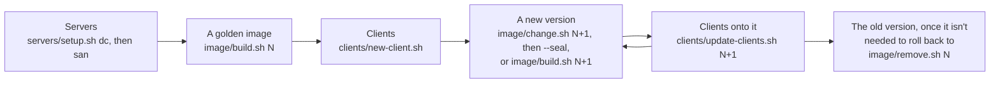

# Operations

Using the scripts from start to finish, what happens when a server restarts and how to recover, what common failures look like, and what this setup doesn't do. [scripts.md](scripts.md) describes each script.

## Workflow



Every script runs from the repo's root directory on the admin workstation, in bash, and is safe to run again after a failure.

### Before you start

- **Two Windows Server 2025 machines** with their static addresses, OpenSSH Server accepting your key for `admin`, a CD drive with the Windows 11 media in the domain controller, and a blank data disk in the storage server ([requirements.md](requirements.md)). [lab.md](lab.md) makes them on Proxmox with Terraform.
- **Your environment's values** in [servers/settings.psd1](../servers/settings.psd1): the domain, the servers' addresses, the DHCP scope, the image's locale and the IQN prefix.
- **The passwords,** in `.env`, copied from [.env.example](../.env.example):
  - `ADMIN_PASSWORD`: the servers' `admin` and `Administrator` password. After the promotion, it's the password of the domain's `admin` and `Administrator`.
  - `DSRM_PASSWORD`: the domain controller's Directory Services Restore Mode password, 16 or more letters and digits.
  - `IMAGE_PASSWORD`: the golden image's local administrator password, 16 or more letters and digits. Every client has it, so keep it apart from the servers'.
- **For the scripts that drive VMs** (`image/build.sh`, `change.sh`, `nic-test.sh`, `clients/check.sh`): the Proxmox API token loaded, in WSL ([lab.md](lab.md#proxmox-access)).

### 1. The servers

```sh
servers/setup.sh dc     # promote to a new forest, then DNS, DHCP, TFTP, HTTP and the boot files
servers/setup.sh san    # join the domain, then iSCSI Target Server and the data disk
```

A script that needs a restart (for pending updates, the promotion or the join) restarts Windows, and `setup.sh` runs it again once Windows is back. Each ends with a check: every boot file fetched anonymously over HTTP, TFTP listening, and the DHCP policies on the domain controller; the target listening on the storage server.

**Check:** a machine that network-boots now reaches the menu for machines that aren't clients, where `m` starts Memtest86+.

### 2. A golden image

```sh
image/build.sh 1               # golden-v1; --updates installs Windows updates in it
```

It refuses a version that's built already, and replaces an unfinished build of the same version. The first build also installs the Windows ADK and makes WinPE. If WinPE fails, it stops at a prompt on the build machine's console, and `build.sh` gives up after 45 minutes, leaving the machine on for a look.

### 3. Clients

1. **Add the client** to [clients/clients.csv](../clients/clients.csv): its name (a computer name: up to 15 letters, digits and hyphens), its MAC, and an address in the reserved range.
2. **Make it:**
   ```sh
   clients/new-client.sh ws-1         # on the newest sealed image; or a version: clients/new-client.sh ws-1 2
   ```
3. **Switch it on.** A physical machine needs UEFI network boot with Secure Boot off, and the clients' network as its native network. Its first boot restarts once, and it's at the logon screen, joined to the domain, 5–7 minutes after it's switched on.
4. **Check it:**
   ```sh
   clients/check.sh ws-1              # --boot to start VM clients that are off, and wait for them
   ```
   For a VM client, it shows the client's name, machine SID, domain and secure channel, NIC, Group Policy, maintenance settings and first boot's log; for any client, its disk and whether it's running.

### 4. Changing an image, and updating clients

```sh
image/change.sh 2               # golden-v2, a copy of the newest sealed image, running on the build machine
ssh admin@<build machine>       # the changes, as the image's admin; or RDP, or its console
image/change.sh 2 --seal        # sysprep, the first boot again, sealed read-only
clients/update-clients.sh 2     # every client in clients.csv onto golden-v2; or name some
```

- **Switch the clients off before updating them.** A running client is reported and left on its old image: switch it off and run the same again.
- **To roll back,** update to the older version, while it's still there.
- **To drop an unsealed change,** switch the build machine off and `image/remove.sh <N>`.
- **A new build** (`image/build.sh 3`) takes the place of a change when the build's scripts or driver pack have changed.

### 5. Removing

```sh
clients/remove-client.sh ws-1   # while it's off: its disk, target, boot script, reservation, DNS records and account
image/remove.sh 1               # an image no disk is on any more
```

### Typical times

| | Time |
|---|---|
| `servers/setup.sh dc`, `san` | About 25 minutes each, with their restarts |
| `image/build.sh` | About 25 minutes; half an hour more the first time, for the ADK and WinPE; up to 4 hours with `--updates` |
| `image/change.sh`, to the image running on the build machine | About 8 minutes: the copy, then the image's first boot |
| `image/change.sh --seal` | About 5 minutes |
| `clients/new-client.sh` | A few seconds |
| A client's first boot | 5–7 minutes, from switching it on to the logon screen |
| `clients/update-clients.sh` | Under a minute; up to 2.5 minutes more for a client switched off a moment ago |

## Server updates and restarts

Both servers download Windows updates, but install them, and restart, only when an admin says so. Plan the restarts:

- **The storage server:** every running client pauses until it's back, for up to 10 minutes. A restart takes well under that. For anything longer, shut the clients down first.
- **The domain controller:** running clients carry on, but nothing can start until it's back, and for 2 minutes after.

## When a server goes away

### The storage server

A client's Windows runs from its disk, so it stops when the iSCSI target does.

| Target away | Clients |
|---|---|
| Up to 10 minutes, such as a restart of the storage server | Pause, and carry on where they were. A restart pauses them for about 35 seconds |
| Longer | Crash (CRITICAL_PROCESS_DIED), and restart. iPXE then retries their disks every 35 seconds or so, and they're back in Windows within a minute of the target |

- **No crash dump:** the dump driver doesn't load on a Windows booted from iSCSI ("Crash dump initialization failed!"), so a crash leaves only its stop code on screen and an unexpected-restart event (Kernel-Power 41).
- **The target can take a minute to listen after the server starts,** if it failed to bind at boot and its startup task restarts it ([requirements.md](requirements.md#storage-server)).
- **Don't restart the iSCSI Target service while clients run.** It stays "Stop Pending" with sessions open, taking connections and answering none, its clients crash once they stop waiting, and their iPXE hangs trying to attach the disk.

**To recover a client** that went down: once the target listens again, nothing, if it's at iPXE's "Booting windows failed", as it retries by itself. Anywhere else, restart it. If the iSCSI Target service is stuck stopping, end its process, then start it:

```powershell
Stop-Process -Id (Get-CimInstance Win32_Service -Filter "Name='WinTarget'").ProcessId -Force
Start-Service WinTarget
```

### The domain controller

Running clients don't need it: their disk is on the storage server, and their boot NIC's address, from the iBFT, never expires.

| | With the domain controller away |
|---|---|
| Running clients | Carry on. Their secure channel with the domain recovers once it's back |
| Names | Fail: it's the clients' DNS server. So the internet by name fails too. Domain logons work only for users with a logon cached on that client |
| A client that starts | Gets no address, tries IPv6 PXE and HTTP boot, and stops at "No bootable option or device was found" after about 5 minutes |
| A client that starts in its first 2 minutes back | Gets an address, but no boot file: DHCP answers within seconds of the domain controller starting, but WDS's TFTP only about 2 minutes later. It stops at "No bootable option" too |

**To recover a client** that started while the domain controller was away, or just after it started: restart it once the domain controller has been up for a few minutes.

## Troubleshooting

### Network boot

| Symptom | Cause | Fix |
|---|---|---|
| A VM has no network boot option at all, and stops at "No bootable option or device was found" without sending a DHCP request | OVMF disables network boot without a random number generator | Give the VM a virtio-rng device |
| "No bootable option or device was found" after about 5 minutes of trying, with no address (PXE-E18) | No DHCP server: the domain controller is down | Restart the client once the domain controller is up ([above](#the-domain-controller)) |
| An address, then a TFTP timeout (PXE-E18), soon after the domain controller started | WDS's TFTP starts about 2 minutes after the domain controller boots | Restart the client |
| The firmware asks TFTP for `boot\x64\wdsmgfw.efi` | DHCP option 60 is set, as WDS sets it by default | `wdsutil /Set-Server /DhcpOption60:No`, and remove option 60 |
| WDS stops as it starts, and nothing listens on UDP 69 | Its PXE provider failed beside the DHCP server (0x425), or it started before Active Directory answered (0x4F1), and either stops the whole server | `IsCritical` 0 for the PXE provider; delayed start, with restarts after any failure ([requirements.md](requirements.md#tftp)) |
| The DHCP server offers an address and then refuses it (a NACK, PXE-E07) | An exclusion range changed without a DHCP server restart; or, in a /16, an exclusion that ends at `.254` lets `.255` out | End the exclusion at `.255`, and restart the DHCP server |
| iPXE: "Permission denied" | HTTP 401: IIS's anonymous user can't read the file | `icacls <BootFiles> /reset /t` |
| iPXE: a file that's there isn't found | IIS has no MIME type for its extension | Add one ([requirements.md](requirements.md#http)) |
| A client gets the menu for machines that aren't clients | No `clients/{mac}.ipxe` for its MAC | Check its MAC in `clients.csv`, and run `new-client.sh` |
| iPXE: "Booting windows failed", and it retries every 30 seconds | Its disk isn't on its target: the storage server is away, the target isn't listening, or an update is in progress or failed | It boots once the disk is there. Run a failed update again |

### Builds

| Symptom | Cause | Fix |
|---|---|---|
| WinPE makes the iSCSI boot session but the disk never appears, and the target logs no login | The iBFT has the network's gateway, and Windows routes iSCSI through it | `set net0/gateway 0.0.0.0` in iPXE before `sanhook` and `sanboot` |
| Boot Manager under wimboot: `\EFI\Microsoft\Boot\BCD` missing (0xc000000f) | wimboot found no BCD | Serve the ADK's WinPE media's `BCD` and `boot.sdi` with `boot.wim` |
| Setup: "Windows could not apply the Windows PE bootstrap setting" | The answer file's drivers are in the windowsPE pass, which setup also applies to the running WinPE | Put them in the offlineServicing pass |
| Setup closes itself at the disk selection | Windows 11 24H2's new setup, at an iSCSI disk | Run the previous version, `sources\setup.exe` |
| Setup: "Windows installation cannot continue because a required driver could not be installed" (0x80070001) | The build machine's NIC is virtio, whose driver setup can't make a boot driver | Build on an Intel NIC |
| A build or change refuses to start just after a build machine was switched off | The target keeps a powered-off initiator's session for about 2 minutes | Wait; the scripts wait up to 5 minutes |
| Sysprep fails with "Failed to query pending CBS operations" (0x80010108) | Windows servicing is still finishing updates | Wait for `TiWorker` to stop, and run sysprep again (`generalize.ps1` does) |
| The seal: "isn't reflected" | DISM didn't make a NIC driver package a boot driver | The package or its INF; see DISM's log in the storage server's `C:\Windows\Logs\DISM` |

### Windows on a client

| Symptom | Cause | Fix |
|---|---|---|
| INACCESSIBLE_BOOT_DEVICE as soon as Windows starts | The NIC's driver isn't a boot driver in the image: its family isn't in the driver pack, or the image wasn't sealed by `seal.ps1` | Add its driver to the pack, and build ([golden-image.md](golden-image.md#the-driver-pack)) |
| INACCESSIBLE_BOOT_DEVICE a few minutes into the boot | The NIC has no interface in the image: a new NIC, or one moved to another slot, without a first boot | Run the first boot again ([clients.md](clients.md#the-first-boot)), or give the client a new disk |
| The first-boot WinPE stops: "the image has no driver service" | The NIC's family isn't in the driver pack | As above |
| The first-boot WinPE: "No disk" | WinPE couldn't reach the disk through this NIC: its driver isn't in WinPE | Add the driver to the pack and make WinPE again |
| Clients crash with CRITICAL_PROCESS_DIED | The storage server was away for longer than they wait | They come back by themselves ([above](#the-storage-server)) |
| A client's disk grows by gigabytes in its first half hour | Windows' automatic maintenance, on an image without the maintenance settings | Seal images with `generalize.ps1` ([golden-image.md](golden-image.md#keeping-clients-disks-small)) |

### Servers and scripts

| Symptom | Cause | Fix |
|---|---|---|
| The iSCSI Target service runs, but nothing listens on port 3260 (event 10, error 10049) | It started before the server's address was usable | The startup task restarts it a minute after boot. By hand, with no clients running: `Restart-Service WinTarget` |
| The iSCSI Target service stays "Stop Pending" | It was restarted with sessions open | End its process ([above](#the-storage-server)) |
| SSH to the servers times out, or resets mid-transfer, while ping and RDP work | An intrusion prevention system takes bursts of SSH connections for a scan | Allow-list the workstation to the servers' network. Blocks lapse after a few minutes |
| The domain promotion refuses: "this computer needs to be restarted" | A new server installs updates by itself, and leaves a restart pending | The scripts restart and run again by themselves |

## Limitations

- **Not supported by Microsoft:** iSCSI boot is supported only on Windows Server, not on client versions of Windows. It works with iPXE, but there's no vendor support.
- **Secure Boot is off.** iPXE's Microsoft-signed shim is the way to turn it on.
- **No CHAP:** a target accepts any machine that presents the client's IQN.
- **WDS is deprecated** from the next Windows Server release. Any TFTP server that serves `snponly.efi` replaces it.
- **One storage server:** every client stops with it, and there are no backups.
- **A NIC family boots only if its driver is in the image's driver pack,** and whether a new family's driver boots is known only once a machine with that NIC has booted the image. The Intel package covers many physical Intel 1 GbE NICs; workstations' Realtek and newer Intel NICs need their own packages.
- **About 1.5 GB of a new client's growth at its first maintenance is unexplained:** single small writes into some 500 directories of Windows' apps and their assets (`Windows\SystemApps`, `SystemResources`, `ImmersiveControlPanel`, Edge's), 4 to 9 minutes into maintenance. A trace of file operations by process would show what makes them.
- **No crash dumps** on clients.
- **Anything stored on a client is wiped** at the next update. User data belongs on a share.
- **Clients aren't activated:** they use the KMS client key, with no KMS host.
- **Each image change generalises the image again,** and leaves some of its own session behind. Build afresh from time to time.

## Sources

- Microsoft, [About iSCSI Boot](https://learn.microsoft.com/en-us/previous-versions/windows/it-pro/windows-server-2008-R2-and-2008/ee619722(v=ws.10)): "iSCSI Boot is supported only on Windows Server. Client versions … are not supported."
- Microsoft Storage team, [Diskless servers can boot and run from the Microsoft iSCSI Software Target using a regular network card](https://learn.microsoft.com/en-us/archive/blogs/storageserver/diskless-servers-can-boot-and-run-from-the-microsoft-iscsi-software-target-using-a-regular-network-card): restarting the target while clients run causes unexpected behaviour, like removing a local disk.
- Microsoft, [KB5129631](https://support.microsoft.com/help/5129631): WDS deprecated in the next Windows Server release.
- Proxmox developers' list, [OVMF without an RNG](https://lists.proxmox.com/pipermail/pve-devel/2025-September/075129.html): "the OVMF firmware disables PXE boot for guests without a random number generator".
- iPXE developers' list, [shim signed by Microsoft](https://lists.ipxe.org/pipermail/ipxe-devel/2025-November/007651.html).
