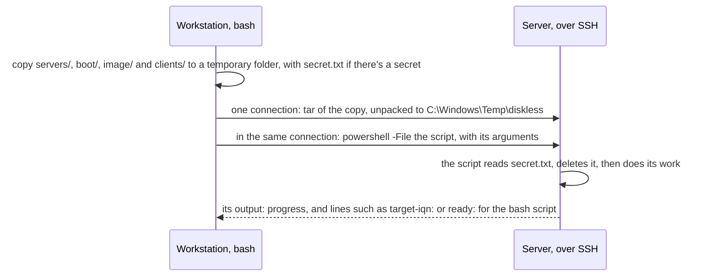

# Scripts

What each file in the repo is for, how the scripts run on the Windows machines, where the settings live, and which parts are tied to Proxmox. [operations.md](operations.md) has the workflow.

## How the scripts run

The bash scripts run on the admin workstation, from the repo's root. Each step of theirs runs one PowerShell script on one Windows machine over SSH, through `run` in [servers/remote.sh](../servers/remote.sh):

- **Each run replaces the copy** in `C:\Windows\Temp\diskless`, so run only one of the repo's scripts at a time against a server. The scripts find each other, and the settings, relative to the copy.
- **Secrets** go along as `servers\secret.txt` in the copy: a password, or a domain join's data. The script reads it and deletes it before anything else ([common.ps1](../servers/common.ps1), `Read-Secret`). Nothing secret goes on a command line.
- **Restarts.** A script that needs Windows restarted (pending updates, a promotion, a domain join) starts the restart and prints `restarting: <why>` with Windows' boot time. `converge` then waits for the boot time to change, polling once a minute, and runs the script again; each script skips what's done. Up to six restarts.
- **Windows servicing first.** Before changing anything, the server scripts wait for Windows servicing (`TiWorker`) to go idle, and restart if it left a restart pending. A role install that meets a shutdown already under way counts as a restart too.
- **Few SSH connections:** one per step, and a restart polled once a minute, with keepalives that end a session whose server restarted under it. An intrusion prevention system in blocking mode can take bursts of new SSH connections for a scan. Host keys aren't checked, as a rebuilt server reuses its address.
- **As whom:** `admin` on every machine, apart from the domain controller's [configure.ps1](../servers/dc/configure.ps1), which runs as the domain's `Administrator`, the account that can authorise the DHCP server. After the promotion, the server's local accounts are domain accounts, and the keys in `administrators_authorized_keys` work for both.
- **Templates.** Files with `@NAME@` placeholders are filled in on the server (`Expand-Template`). Batch files are written with CRLF line endings; iPXE scripts and shell scripts must have LF, which [.gitattributes](../.gitattributes) keeps.

## Settings and secrets

| File | What |
|---|---|
| [servers/settings.psd1](../servers/settings.psd1) | The environment's values, read by every PowerShell script and by `remote.sh`. Listed below |
| `.env`, from [.env.example](../.env.example) | `ADMIN_PASSWORD`, `DSRM_PASSWORD`, `IMAGE_PASSWORD`, read by the bash scripts. Git ignores it |
| [clients/clients.csv](../clients/clients.csv) | `name,mac,address` for each client |
| [image/drivers.psd1](../image/drivers.psd1) | The driver pack: each package's URL, pinned SHA-256, and for an ISO, the folders to take |
| [lab/lab.auto.tfvars](../lab/lab.auto.tfvars) | The lab's Proxmox values ([lab.md](lab.md)) |

| Setting | What it is |
|---|---|
| `DomainName`, `NetbiosName` | The clients' domain |
| `DcAddress`, `SanAddress`, `Gateway` | The servers' static addresses, and the network's gateway, which is also where the domain controller forwards DNS queries outside the domain |
| `Network`, `SubnetMask` | The flat network: a /8, /16 or /24, for the reverse DNS zone, and its mask, for the DHCP scope |
| `ScopeStart`, `ScopeEnd` | The DHCP scope |
| `ReservedStart`, `ReservedEnd` | The range kept out of the dynamic pool, for clients' and the build machine's reservations |
| `BootFiles`, `TftpRoot` | On the domain controller: the folder IIS serves as `/boot`, and WDS's TFTP root |
| `SanDataDrive` | The storage server's data disk's drive letter; images and clients' disks go under `iSCSI\` on it |
| `InstallShare`, `ShareAccount` | On the domain controller: the install share's folder, and the domain account WinPE maps it with |
| `ImageIndex`, `ProductKey` | The edition in the media's `install.wim`, and its KMS client key |
| `ImageSizeGB`, `ImageUser` | The golden image's size, and its local administrator |
| `Locale`, `UILanguage`, `TimeZone` | The image's regional settings |
| `BuildVm` | The build machine's VM name, as the hypervisor knows it |
| `IqnPrefix` | Initiators are `<IqnPrefix>:<name>`, for the build machine and each client |
| `ClientOu`, `ClientGpo`, `PagefileMB` | The clients' OU and GPO, and their fixed pagefile size |

## Files

### servers/

| File | Runs on | What it does |
|---|---|---|
| [setup.sh](../servers/setup.sh) | Workstation | `setup.sh dc` runs `promote.ps1`, then `configure.ps1`, on the domain controller; `setup.sh san` runs `join.ps1`, then `configure.ps1`, on the storage server |
| [remote.sh](../servers/remote.sh) | Workstation | Sourced by every bash script: the servers' addresses from `settings.psd1`, SSH options, `run` and `converge` ([above](#how-the-scripts-run)) |
| [common.ps1](../servers/common.ps1) | Servers | Dot-sourced by every PowerShell script: the settings (`$s`), secrets, templates, restarts, Windows Update policy, and the storage server's helpers: waiting for a target to be idle, finding the newest sealed image, the build target, mounting a disk's Windows volume, `reg.exe` as SYSTEM, and making NIC drivers boot drivers (`Set-BootNicDrivers`) |
| [settings.psd1](../servers/settings.psd1) | | The environment's values ([above](#settings-and-secrets)) |
| [dc/promote.ps1](../servers/dc/promote.ps1) | Domain controller | AD DS and DNS, and the promotion to the first domain controller of a new forest |
| [dc/configure.ps1](../servers/dc/configure.ps1) | Domain controller | The Windows Update policy; `admin` in Domain Admins and Enterprise Admins; DNS forwarder and reverse zone; DHCP, its scope and network-boot policies; WDS for TFTP; IIS for `/boot`; the pinned downloads; then a check of each ([requirements.md](requirements.md#domain-controller)) |
| [san/join.ps1](../servers/san/join.ps1) | Storage server | Joins the domain |
| [san/configure.ps1](../servers/san/configure.ps1) | Storage server | The Windows Update policy; iSCSI Target Server, and the startup task that makes sure it listens; the data disk ([requirements.md](requirements.md#storage-server)) |

### boot/

The iPXE scripts, copied to `<BootFiles>` on the domain controller by `configure.ps1` and by every script that writes a boot script, so that changes to them land with the next run.

| File | What it does |
|---|---|
| [boot.ipxe](../boot/boot.ipxe) | What every machine's iPXE fetches first: the machine's own `clients/{mac}.ipxe`, or `menu.ipxe` |
| [menu.ipxe](../boot/menu.ipxe) | The menu for machines that aren't clients: WinPE, Memtest86+, an iPXE shell, or the next boot device |
| [client.ipxe](../boot/client.ipxe) | The clients' menu: Windows from the disk, WinPE with the disk attached, Memtest86+, a shell. Clears the gateway first. Goes back to the menu, and so to Windows, 30 seconds after a failed boot |
| [build.ipxe](../boot/build.ipxe) | The build machine's boot during a build or change: WinPE with the build disk attached (`setup`), or Windows from it (`windows`) |

### image/

| File | Runs on | What it does |
|---|---|---|
| [build.sh](../image/build.sh) | Workstation | Builds golden image `<N>`: the build disk, the domain controller's preparation, WinPE and setup on the build machine, Windows and sysprep, the seal, and the cleanup ([golden-image.md](golden-image.md#how-an-image-is-built)). `--updates` installs Windows updates in it |
| [change.sh](../image/change.sh) | Workstation | `change.sh <N> [<from>]` starts golden image `<N>`, a copy of `<from>` or the newest sealed image, on the build machine; `change.sh <N> --seal` seals it ([golden-image.md](golden-image.md#changing-an-image)) |
| [remove.sh](../image/remove.sh) | Workstation | Deletes golden image `<N>`, unless a disk is on it or the build machine is running it |
| [nic-test.sh](../image/nic-test.sh) | Workstation | Boots golden image `<N>` on a VM client, on a new disk, and passes if Windows finishes its first boot within 20 minutes; it prints the client's NIC and its driver. The default variant, `none`, boots the image as it is. The others change the disk first, to diagnose an image that doesn't boot a NIC: `bootflags` and `bootstart` set `BootFlags` 1 (and `Start` 0) on the services of the image's installed NICs; `reflect` makes the image's NIC drivers boot drivers, as the seal does; `netadapter` boots WinPE first to run `/Add-NetAdapter`. **It replaces the client's disk,** and afterwards removes the client's disk, target and boot script, unless `--keep`: use a VM that isn't a client, or make the client again afterwards |
| [drivers.psd1](../image/drivers.psd1) | | The driver pack ([golden-image.md](golden-image.md#the-driver-pack)) |
| [dc/prepare.ps1](../image/dc/prepare.ps1) | Domain controller | Once: the Windows ADK and WinPE add-on, the install share with the media, driver pack and guest agent, WinPE and the first-boot WinPE. Each build: the share account's new password, the build's answer files and files for the image, WinPE's job, and the build machine's boot script |
| [dc/build-script.ps1](../image/dc/build-script.ps1) | Domain controller | The build machine's `clients/{mac}.ipxe` for a phase, `setup` or `windows`, and its DHCP reservation |
| [dc/cleanup.ps1](../image/dc/cleanup.ps1) | Domain controller | When a build or change ends: removes the build's files, WinPE's job and the boot script, and disables the share account with a new random password |
| [dc/test-client.ps1](../image/dc/test-client.ps1) | Domain controller | A test client's boot script and WinPE job, for `nic-test.sh` |
| [san/build-disk.ps1](../image/san/build-disk.ps1) | Storage server | The build target, for the build machine's IQN, with a blank image on it |
| [san/change-disk.ps1](../image/san/change-disk.ps1) | Storage server | A writable copy of a sealed image on the build target, or the unfinished change that's there; with `-Check`, that the build machine is running the change |
| [san/seal.ps1](../image/san/seal.ps1) | Storage server | Takes the image off the build target, checks it's generalised and has the first boot, makes its NIC drivers boot drivers, and makes it read-only ([golden-image.md](golden-image.md#the-seal)) |
| [san/remove-image.ps1](../image/san/remove-image.ps1) | Storage server | Deletes an image for `remove.sh`, and lists those left |
| [san/test-client.ps1](../image/san/test-client.ps1) | Storage server | A test client's disk and target, changed for the variant, for `nic-test.sh` |
| [san/read-client.ps1](../image/san/read-client.ps1) | Storage server | Prints files from a test client's disk while it's off, such as WinPE's log |
| [winpe/startnet.cmd](../image/winpe/startnet.cmd) | WinPE | WinPE's startup: fetches the machine's job over HTTP and runs it, or leaves WinPE at a prompt |
| [winpe/build.cmd](../image/winpe/build.cmd) | WinPE, build machine | The build's job: maps the share, waits for the iSCSI disk, runs setup onto it, copies the image's first-logon files in, and powers off. On a failure, prints why the disk is missing |
| [winpe/startnet-firstboot.cmd](../image/winpe/startnet-firstboot.cmd) | First-boot WinPE | Its startup: waits for the client's disk, then runs `firstboot.ps1` from it |
| [winpe/firstboot.ps1](../image/winpe/firstboot.ps1) | First-boot WinPE, client | A client's first boot: the NIC's interface if the image lacks it, then Windows as the boot manager's default, and a restart ([clients.md](clients.md#the-first-boot)) |
| [winpe/netadapter.cmd](../image/winpe/netadapter.cmd) | WinPE, test client | `nic-test.sh`'s `netadapter` job: `/Add-NetAdapter` for the client's NIC on its disk, with `BootFlags` 1 on its driver's service |
| [windows/autounattend.xml](../image/windows/autounattend.xml) | Setup | The install onto the iSCSI disk: partitions, edition and key, the driver pack, no device encryption, accounts, and one logon to run `firstlogon.ps1` |
| [windows/firstlogon.ps1](../image/windows/firstlogon.ps1) | The image, build | Windows Update off, the guest agent, OpenSSH, updates, RDP and ping, power settings, the iSCSI timeout; then `generalize.ps1` at the next startup |
| [windows/generalize.ps1](../image/windows/generalize.ps1) | The image, build and change | The maintenance settings and .NET's native images, sysprep, the first-boot entry, then power off |
| [windows/sysprep.xml](../image/windows/sysprep.xml) | Sysprep | Keeps installed devices; the answers for a client's first boot |
| [windows/firstboot-entry.ps1](../image/windows/firstboot-entry.ps1) | The image | Moves the first-boot WinPE into `Windows\Setup\Diskless`, and makes its boot entry the default |
| [windows/iscsi-timeouts.ps1](../image/windows/iscsi-timeouts.ps1) | The image | `MaxRequestHoldTime` 600 on the iSCSI initiator |
| [windows/reseal.ps1](../image/windows/reseal.ps1) | The image, change | For `change.sh --seal`: puts back what a build leaves for `generalize.ps1`, sets it to run at the next startup, and restarts |

### clients/

| File | Runs on | What it does |
|---|---|---|
| [new-client.sh](../clients/new-client.sh) | Workstation | Makes a client from its row in `clients.csv` ([clients.md](clients.md#making-a-client)) |
| [update-clients.sh](../clients/update-clients.sh) | Workstation | Moves clients that are off to another golden image ([clients.md](clients.md#updating-clients)) |
| [remove-client.sh](../clients/remove-client.sh) | Workstation | Removes a client that's off |
| [check.sh](../clients/check.sh) | Workstation | A client's disk and whether it's running; for VM clients, what Windows reports through the QEMU guest agent. `--boot` starts VM clients and waits until they're set up and joined |
| [clients.csv](../clients/clients.csv) | | The clients |
| [dc/new-client.ps1](../clients/dc/new-client.ps1) | Domain controller | The OU and GPO, a reservation, and the offline domain join |
| [dc/update-clients.ps1](../clients/dc/update-clients.ps1) | Domain controller | The OU, GPO and boot scripts; for each client being updated, its reservation and a new domain join |
| [dc/remove-client.ps1](../clients/dc/remove-client.ps1) | Domain controller | The boot script, reservation and leases, DNS records and computer account |
| [dc/boot-script.ps1](../clients/dc/boot-script.ps1) | Domain controller | A client's `clients/{mac}.ipxe` |
| [dc/client.ps1](../clients/dc/client.ps1) | Domain controller | Shared: a client's reservation, and its domain join from `djoin` |
| [dc/policy.ps1](../clients/dc/policy.ps1) | Domain controller | The clients' OU and GPO, with its settings and startup script ([clients.md](clients.md#group-policy)) |
| [dc/nic-power.ps1](../clients/dc/nic-power.ps1) | Clients, at startup | The GPO's startup script: NIC power saving off |
| [san/new-client.ps1](../clients/san/new-client.ps1) | Storage server | A client's disk, with its identity, and its target |
| [san/update-clients.ps1](../clients/san/update-clients.ps1) | Storage server | `take`: clients' disks off their targets, for clients that are off. `make`: their new disks. Then the images, and how many disks each has |
| [san/remove-client.ps1](../clients/san/remove-client.ps1) | Storage server | A client's target and disk |
| [san/show-client.ps1](../clients/san/show-client.ps1) | Storage server | Clients' disks: size, image, and whether the target has a session |
| [san/disk.ps1](../clients/san/disk.ps1) | Storage server | Shared: a client's differencing disk, with its name and join in the answer file, and `SetupComplete.cmd` |

### lab/

The Proxmox lab ([lab.md](lab.md)).

| File | What it does |
|---|---|
| [main.tf](../lab/main.tf), [lab.auto.tfvars](../lab/lab.auto.tfvars), `.terraform.lock.hcl` | Terraform (bpg/proxmox provider) for the two servers, the clients and the build machine |
| [pve-setup.sh](../lab/pve-setup.sh) | Run as root on a Proxmox node: the pool, roles, user and permissions Terraform runs as |
| [token-env.py](../lab/token-env.py) | Turns a new API token into the environment file Terraform and `pve.sh` read, without showing the secret |
| [bootstrap-server.sh](../lab/bootstrap-server.sh) | Gives a newly cloned server its static address and computer name through the QEMU guest agent, before the network has DHCP |
| [pve.sh](../lab/pve.sh) | The Proxmox API for the scripts: finding a VM, starting and stopping it, its MAC, and running PowerShell through the guest agent |

### The repo's root

| File | What |
|---|---|
| [.env.example](../.env.example) | The passwords to copy into `.env` |
| [.gitattributes](../.gitattributes) | LF line endings for shell, Python, Terraform and iPXE files |
| [.gitignore](../.gitignore) | `.env` and Terraform's state |

## Hypervisor-specific parts

The servers' scripts, the client scripts other than `check.sh`, and everything in the image work on any hypervisor or physical machines. These parts assume Proxmox:

- **[lab/pve.sh](../lab/pve.sh)'s functions,** which `image/build.sh`, `image/change.sh`, `image/nic-test.sh` and `clients/check.sh` use: `find_vm` (by name), `vm_status`, `vm_start`, `vm_stop`, `vm_mac`, `wait_stopped`, and, through the QEMU guest agent, `agent_up`, `guest_ps` and `image_state`. Reimplement them for another hypervisor's API. For a physical build machine, its power on and off would be manual, and the waits would watch the iSCSI target's sessions instead.
- **The build machine's address comes from its MAC.** The lab gives VMs MACs of `02:00` followed by their address in hex, and [image/dc/build-script.ps1](../image/dc/build-script.ps1) and [image/change.sh](../image/change.sh) work the build machine's reservation and address out from its MAC. A build machine with another MAC needs its address from somewhere else, such as a setting.
- **`BuildVm`** in `settings.psd1` is the build machine's VM name in Proxmox.
- **The guest agent** is how `change.sh`, `nic-test.sh` and `check.sh` see into Windows. The image installs the QEMU guest agent for that.
- **[lab/](../lab)** is all Proxmox.
